# Asynchronous FIFO in Verilog

A parameterized asynchronous FIFO (First-In, First-Out buffer) that passes data between two unrelated clock domains. Clock domain crossing (CDC) is handled with Gray-coded read/write pointers and two-flop synchronizers, and each domain gets its own reset synchronizer (asynchronous assert, synchronous deassert).

The design is verified with a self-checking, randomized testbench and with **fault injection**: four deliberately broken variants of the design were run through the same testbench to confirm that it actually catches bugs.

**Tools:** Verilog-2001, Icarus Verilog (simulation), GTKWave 3.3.100 (waveforms)

---

## Block diagram

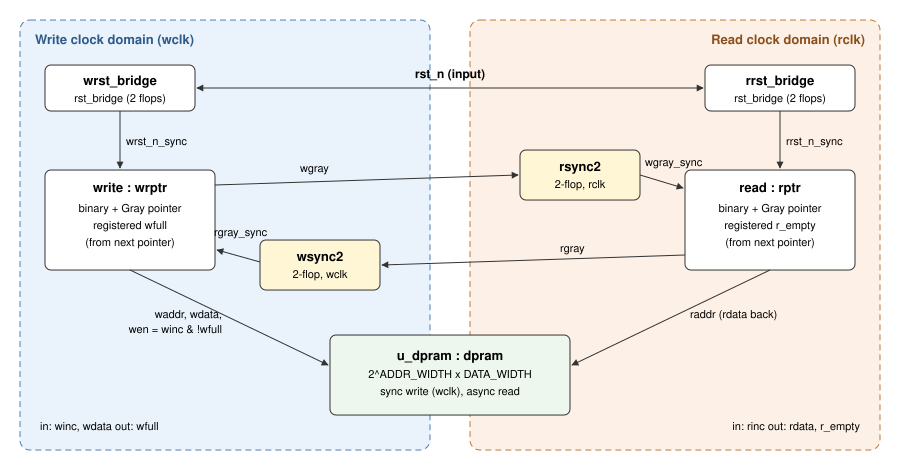

| Module | File | Role |
|---|---|---|
| `fifo` | `rtl/fifo.v` | Top level: connects everything below |
| `wrptr` | `rtl/wrptr.v` | Write pointer (binary + Gray), registered `wfull` |
| `rptr` | `rtl/rptr.v` | Read pointer (binary + Gray), registered `r_empty` |
| `dpram` | `rtl/dpram.v` | Dual-port memory: synchronous write on `wclk`, asynchronous read |
| `sync2` | `rtl/sync2.v` | Two-stage synchronizer for a Gray pointer (built from two `width` registers) |
| `width` | `rtl/width.v` | Parameterized-width D register |
| `rst_bridge` | `rtl/rst_bridge.v` | Reset synchronizer: asynchronous assert, release after 2 clock edges |

### Parameters

| Parameter | Default | Meaning |
|---|---|---|
| `ADDR_WIDTH` | 3 | Address bits; depth = 2^`ADDR_WIDTH` (default 8 entries) |
| `DATA_WIDTH` | 8 | Bits per entry |

Pointers are `ADDR_WIDTH + 1` bits wide. The extra MSB (most significant bit) distinguishes *full* from *empty* when the address bits are equal.

---

## How it works

1. **Gray-coded pointers.** Each side keeps a binary pointer (used to address the RAM) and a Gray-coded copy. Only one bit of a Gray pointer changes per increment, so if the receiving domain samples it mid-transition it sees either the old or the new value, never a corrupted one.
2. **Two-flop synchronizers.** The write Gray pointer crosses into the read domain through `rsync2`, and the read Gray pointer crosses into the write domain through `wsync2`.
3. **Empty** (read side): `r_empty` is set when the *next* read Gray pointer equals the synchronized write Gray pointer.
4. **Full** (write side): `wfull` is set when the *next* write Gray pointer equals the synchronized read Gray pointer with its **top two bits inverted**.
5. Both flags are **registered** and computed from the *next* pointer value, so they take effect on the same clock edge as the pointer update.
6. **Pessimistic flags.** Because the other side's pointer arrives two cycles late, `wfull` may stay asserted slightly longer than necessary and `r_empty` may clear slightly late. This can never cause an overflow or underflow, only a few cycles of extra wait.
7. Writes into the RAM are gated with `wen = winc && !wfull`.

---

## Verification

### Self-checking testbench (`tb/tb_fifo.v`)

- Independent clocks, set by half-period parameters `WHALF` (write) and `RHALF` (read)
- Random `winc` / `rinc` every cycle (`$random`)
- **Scoreboard:** every accepted write is stored in an `expected[]` array, and every read is compared against it
- **Overflow check:** flags an error if writes ever get more than 8 entries ahead of reads
- **Underflow check:** flags an error if reads ever exceed writes
- **Mid-simulation reset** at ~10 µs to check recovery
- Prints `PASS` or `FAIL` with write, read and error counts after ~20 µs

### Results: correct design across clock ratios

| `WHALF` / `RHALF` (ns) | Write : read clock | Result |
|---|---|---|
| 3 / 7 (default) | write faster | PASS: 706 writes, 693 reads |
| 7 / 3 | read faster | PASS: 695 writes, 692 reads |
| 5 / 5 | equal | PASS: 903 writes, 897 reads |
| 5 / 6 | nearly equal | PASS: 833 writes, 822 reads |
| 5 / 6.667 | non-integer ratio | PASS: 755 writes, 742 reads |
| 3 / 31 | ~10x write faster | PASS: 182 writes, 167 reads |

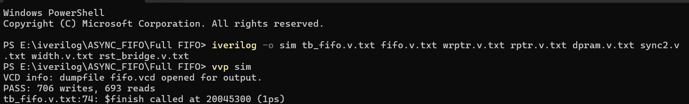

### Waveforms (default ratio: `wclk` period 6 ns, `rclk` period 14 ns)

**Overview, 0–300 ns.** Random writes and reads, with `wfull` and `r_empty` toggling.

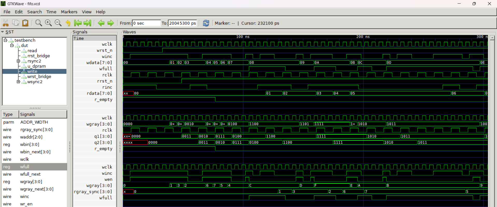

**CDC, empty and full, 0–150 ns.** This view shows:
- **CDC.** The write Gray pointer `wgray` goes to `0011` at ~45 ns. It appears on `rsync2.q1` at the next `rclk` edge (~49 ns) and on `q2` one edge later (~63 ns). Then `r_empty` falls on the following edge (~77 ns), since it is a registered flag.
- **Full.** With `rgray_sync = 0000`, the full pattern is `1100`. `wfull` rises at ~107 ns, the same edge on which `wgray` becomes `1100`.
- **Blocked write.** Around 115–124 ns, `winc` is high but `wen` stays low and `wgray` holds, so no overflow occurs.
- **Full release.** `rgray_sync` updates to `0001` at ~131 ns, and `wfull` clears on the next `wclk` edge.

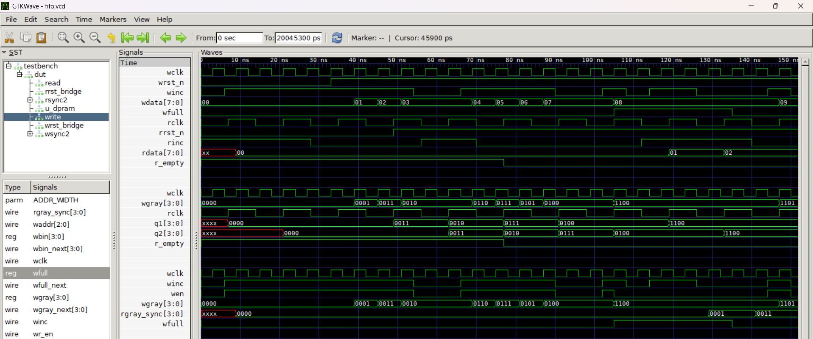

**Full toggling under random traffic, 80–220 ns.**

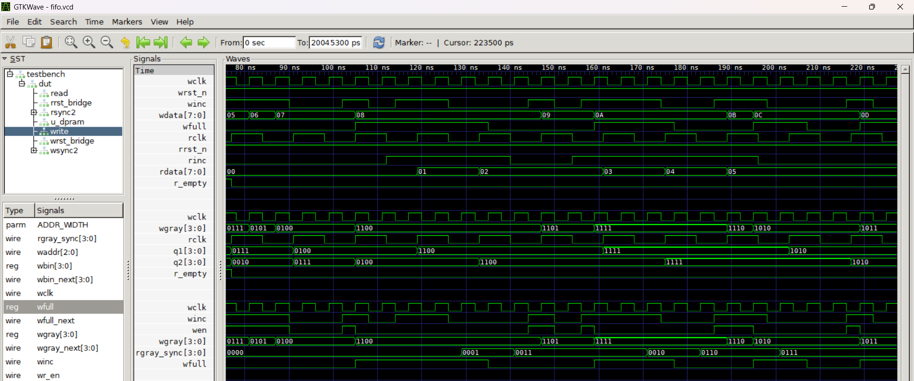

**Mid-simulation reset, around 10 µs.** `rst_n` is low from ~10 025 ns to ~10 045 ns.
- **Assert.** The synchronized resets `wrst_n` and `rrst_n` fall immediately. Pointers clear, `wfull` goes to 0 and `r_empty` goes to 1.
- **Release.** `wrst_n` rises 2 `wclk` edges after `rst_n` (~10 058 ns), and `rrst_n` rises 2 `rclk` edges after (~10 074 ns).
- **Synchronizer flush.** The pointer synchronizers have no reset of their own. They flush to `0000` while the pointer logic is still held in reset.

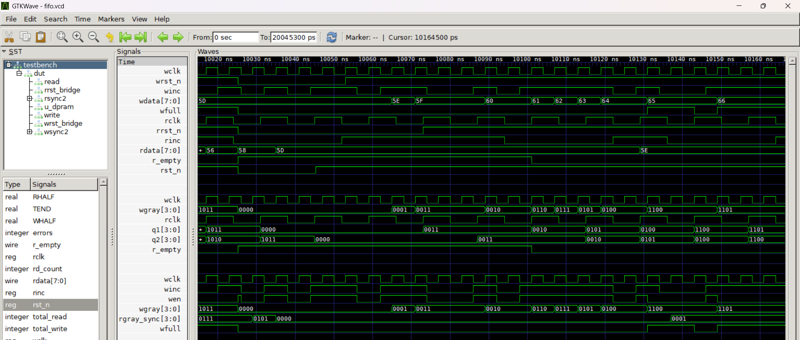

### Fault injection: does the testbench catch real bugs?

Each variant changes one thing in the design and runs through the same testbench.

| # | Bug introduced | File | Ratio | Result | What the testbench saw |
|---|---|---|---|---|---|
| 1 | `wfull` computed from the *current* Gray pointer instead of the *next* one, so full asserts one cycle late | `bugs/wrptr_bug1.v` | 3 / 7 | **FAIL**: 1407 writes, 3843 errors | OVERFLOW from 669 ns, then corrupted read data |
| 2 | `r_empty` resets to `0` instead of `1` | `bugs/rptr_bug2.v` | 7 / 3 | **FAIL**: 2011 errors | Read of never-written data at 39 ns, then persistent UNDERFLOW |
| 3 | RAM write enable ignores `wfull` (`wen = winc`) | `bugs/fifo_bug3.v` | 3 / 7 | **FAIL**: 141 errors | Data mismatches only. Write/read counts were identical to the PASS run, so only the scoreboard caught it. |
| 4 | Both two-flop synchronizers bypassed (pointers cross directly) | `bugs/fifo_bug4.v` | 3 / 7 and 5 / 6 | **PASS** | Not detectable in RTL simulation (see below) |

Notes:
- **Errors can exceed writes** (bug 1). The overflow check fires on every `wclk` cycle while the FIFO is over-filled, so it counts cycles spent in the bad state, not individual bad writes.
- **Bug 2 depends on the clock ratio.** At the default 3 / 7 ratio (write faster) it **passes**. It is only exposed when the read clock is faster (7 / 3). This is why the design is checked across several ratios.
- **Bug 4 passes, and that is expected.** Icarus Verilog does not model metastability, so removing the synchronizers does not cause a functional failure in simulation. The design behavior does change: at 5 / 6 the bypassed design completes 852 writes, versus 833 for the correct design, because flags update without the 2-cycle synchronizer delay. Missing synchronizers have to be caught structurally, for example by CDC lint/analysis tools or design review, not by RTL simulation.

<details>
<summary>Terminal output for each fault-injection run</summary>

Times printed by the testbench are in picoseconds (simulator precision 1 ps), e.g. `669000` = 669 ns.

**Bug 1**
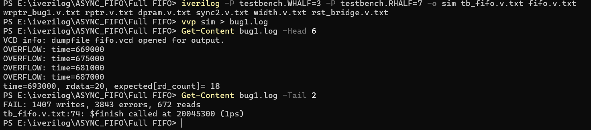

**Bug 2**
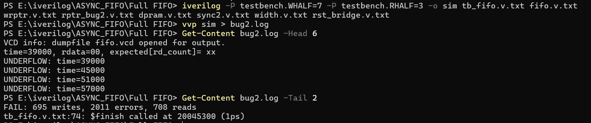

**Bug 3**
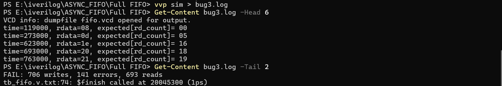

**Bug 4 (3 / 7 and 5 / 6)**
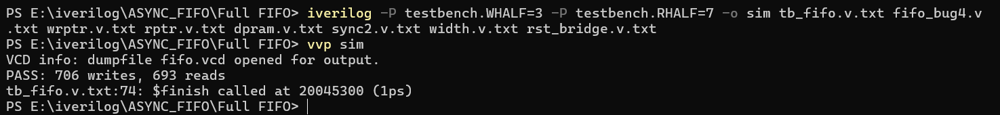
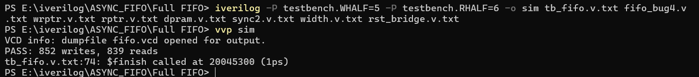

</details>

### Unit testbenches (`tb/unit/`)

Directed testbenches for each submodule (`wrptr`, `rptr`, `dpram`, `sync2`, `width`, `rst_bridge`), used during development. They print signals with `$monitor` and are checked by inspection. They are not self-checking.

---

## Running the simulation

Requires [Icarus Verilog](https://steveicarus.github.io/iverilog/). GTKWave is optional, for viewing waveforms.

**Windows (PowerShell)**
```powershell
.\run_sim.ps1                     # correct design, WHALF=3, RHALF=7
.\run_sim.ps1 -WHalf 5 -RHalf 6   # another clock ratio
.\run_sim.ps1 -Bug 1              # fault-injection run (1..4)
gtkwave fifo.vcd
```

**Linux / macOS**
```sh
./run_sim.sh            # correct design
./run_sim.sh 0 5 6      # bug=0, WHALF=5, RHALF=6
./run_sim.sh 3          # fault-injection run
```

**Manual command**
```sh
iverilog -o sim tb/tb_fifo.v rtl/fifo.v rtl/wrptr.v rtl/rptr.v rtl/dpram.v rtl/sync2.v rtl/width.v rtl/rst_bridge.v
vvp sim
```

**A unit testbench**, e.g. the write pointer:
```sh
iverilog -o sim tb/unit/tb_wrptr.v rtl/wrptr.v
vvp sim
```

---

## Known limitations

- **Depth is always a power of 2** (2^`ADDR_WIDTH`), as required by this Gray-code pointer scheme.
- **The overflow check is hardcoded to 8.** The testbench line `wr_count - rd_count > 8` matches only `ADDR_WIDTH = 3`. Changing `ADDR_WIDTH` requires updating that constant.
- **The testbench only runs the default parameters.** All results above are for `ADDR_WIDTH = 3`, `DATA_WIDTH = 8`.
- **Read data is combinational from the RAM** (`rdata = mem[raddr]`), not registered.
- **No metastability modeling.** Simulation verifies function, not CDC robustness (see bug 4).

---

## Repository layout

```
rtl/         design sources
tb/          self-checking top-level testbench
tb/unit/     directed unit testbenches for each submodule
bugs/        fault-injection variants
docs/        block diagram, waveform and terminal screenshots
run_sim.ps1  Windows runner
run_sim.sh   Linux/macOS runner
```
